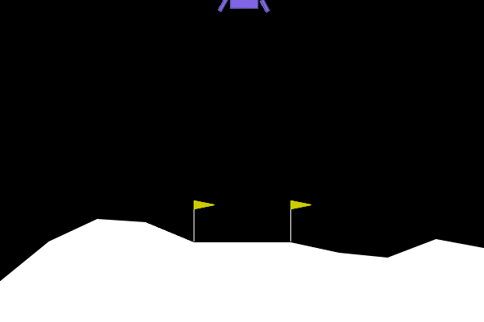

# 🚀 Autonomous Rocket Landing with Deep Q-Networks (DQN)

An autonomous rocket landing agent built using **Deep Reinforcement Learning (DQN)** inside the **Gymnasium LunarLander-v3** physics simulation (Box2D).



---

## 📊 Benchmark Test Report (100 Unseen Flights)

The agent was evaluated across **100 consecutive, brand-new physics seeds** with frozen weights and zero random exploration ($\epsilon = 0$):

| Metric | Result | Benchmark Target | Status |
| :--- | :--- | :--- | :--- |
| **Mean Score (Average)** | **`243.00`** | $\ge 200.00$ | 🏆 **SOLVED** |
| **Safe Landing Rate** | **`91.0%`** (91/100) | $\ge 80.0\%$ | ✅ Passed |
| **Crash Rate** | **`0.0%`** (0/100) | $\le 5.0\%$ | 🎯 Perfect |
| **Max Score** | **`298.96`** | ~300.00 max | 🚀 Elite |
| **Avg Flight Duration** | **`370.9 steps`** (~7.4s) | — | Optimal |

---

## 🛠️ Architecture & Physics

### Observation Space (8 State Dimensions):
1. **$x$ coordinate**: Horizontal displacement from the landing pad.
2. **$y$ coordinate**: Altitude.
3. **$v_x$**: Horizontal velocity.
4. **$v_y$**: Vertical velocity (descent speed).
5. **$\theta$**: Rocket orientation tilt (radians).
6. **$\omega$**: Angular velocity (rotation speed).
7. **Left leg contact**: 1 if touching ground, 0 otherwise.
8. **Right leg contact**: 1 if touching ground, 0 otherwise.

### Action Space (4 Discrete Actions):
* `0`: Do nothing (coast)
* `1`: Fire left orientation thruster (rotates right)
* `2`: Fire main rocket booster (counteracts gravity)
* `3`: Fire right orientation thruster (rotates left)

### Neural Network:
* **Architecture**: 3-layer Multi-Layer Perceptron (MLP)
  * Input (8) $\to$ Dense(64, ReLU) $\to$ Dense(64, ReLU) $\to$ Output (4 Q-values)
* **Optimization**: Adam (`lr=5e-4`), Mean Squared Error Bellman Loss, Soft Target Network updates ($\tau = 0.001$).

---

## 🚀 Quickstart

### 1. Install Dependencies
```bash
pip install torch pygame "gymnasium[box2d]"
```

### 2. Watch the Trained Rocket Fly
Launch the continuous, interactive visual simulation:
```bash
python watch_rocket.py
```
* **Controls**:
  * `SPACE`: Pause / Resume flight
  * `R`: Instantly restart flight
  * `ESC` / Close Window: Exit

### 3. Run the 100-Flight Benchmark Evaluation
Evaluate the model across 100 unseen flight seeds and print statistical metrics:
```bash
python evaluate_model.py
```

### 4. Retrain from Scratch
```bash
python quickstart_lander.py
```

---

## 📁 Repository Structure
```
rocket_lander_rl/
├── quickstart_lander.py   # Complete DQN training script (~190 lines)
├── watch_rocket.py        # Interactive Pygame visual flight player
├── evaluate_model.py      # 100-episode headless benchmark test suite
├── rocket_lander_model.pth # Pre-trained model weights (solved checkpoint)
├── rocket_landing.gif     # Animated flight replay
├── .gitignore
└── README.md
```
